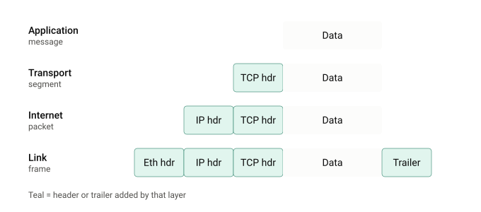
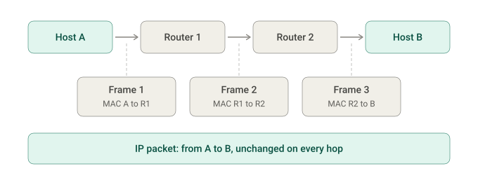
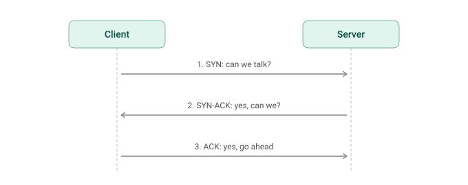
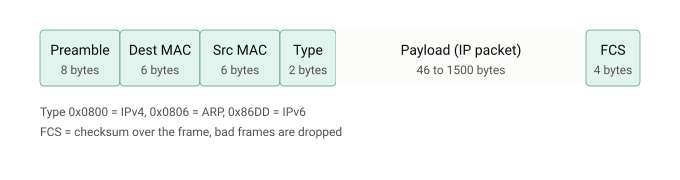
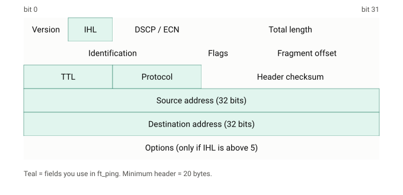
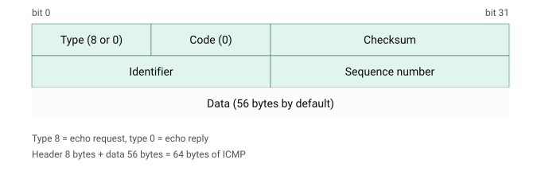

# Internetprotokollfamilie

### Technischer Ablauf

1. Die Argumente und Optionen werden geprüft.
2. `getaddrinfo()` löst den Hostnamen mit `AF_INET` in eine IPv4-Adresse auf.
3. Das Programm öffnet mit `socket(AF_INET, SOCK_RAW, IPPROTO_ICMP)` einen Raw Socket.
4. Eine ICMP-Nachricht mit Typ 8, Code 0, Prozess-ID als Identifier und einer fortlaufenden Sequenznummer wird aufgebaut.
5. Die Checksumme wird über alle 16-Bit-Wörter der ICMP-Nachricht berechnet.
6. Die Anfrage wird regelmäßig mit `sendto()` gesendet und die Antwort mit `recvmsg()` empfangen.
7. Der IP-Header der Antwort wird anhand der IHL-Länge übersprungen; daraus wird unter anderem die TTL gelesen.
8. Antworten mit einer fremden Identifier werden ignoriert, damit nur die eigenen Anfragen ausgewertet werden.
9. Die RTT wird aus dem Zeitstempel in den Nutzdaten und einer monotonen Uhr berechnet.
10. ICMP-Fehler wie `Destination Unreachable` (Typ 3) und `Time Exceeded` (Typ 11) werden erkannt und ausgegeben.
11. Beim Beenden werden Paketverlust und `min/avg/max/stddev` berechnet.

### Aufbau eines `ft_ping`-Pakets

Eine typische Echo-Anfrage besteht aus:

| Bestandteil | Größe | Inhalt |
| --- | ---: | --- |
| ICMP-Header | 8 Bytes | Typ, Code, Checksumme, Identifier und Sequenznummer |
| ICMP-Nutzdaten | 56 Bytes | Zeitstempel und Auffüllbytes |
| ICMP-Nachricht insgesamt | 64 Bytes | Wird als `64 bytes from ...` ausgegeben |
| IPv4-Header | mindestens 20 Bytes | Wird vom Kernel ergänzt |

Bei einem Raw Socket erstellt das Programm den ICMP-Teil. Der Kernel ergänzt den IP-Header. Auf dem lokalen Netzwerk wird das IP-Paket anschließend in einen Link-Layer-Frame, zum Beispiel einen Ethernet-Frame, eingebettet.

### Fehlerbehandlung mit `-v`

ICMP-Fehlernachrichten enthalten den ursprünglichen IP-Header und die ersten Bytes des ursprünglichen ICMP-Pakets. Dadurch kann `ft_ping` die Fehlermeldung der eigenen Anfrage zuordnen. Eine niedrige TTL kann verwendet werden, um für Testzwecke eine `Time Exceeded`-Meldung zu erzeugen. Solche Meldungen dürfen die laufende Messung nicht unerwartet beenden.

### Bonusoptionen

Die folgenden Erweiterungen sind derzeit nicht implementiert:

- [ ] `-f` Flood-Modus
- [ ] `-l` Preload
- [ ] `-n` Numerische Ausgabe
- [ ] `-w` Deadline
- [ ] `-W` Timeout
- [ ] `-p` Paketmuster
- [ ] `-r` Routing umgehen
- [ ] `-s` Paketgröße
- [ ] `-T` / `--ttl`
- [ ] `--ip-timestamp`

Die Bonusfunktionen werden nur bewertet, wenn der Pflichtumfang vollständig und fehlerfrei funktioniert.

# Netzwerkgrundlagen

### Schicht 1: Verbindungsschicht (der lokale Link)

Der Link umfasst alle Maschinen, die du erreichen kannst, ohne einen Router zu überqueren: dein WLAN oder ein einzelnes Ethernet-Segment.
Er rahmt das Paket ein, übergibt es an die Netzwerkkarte und sendet es über das physische Medium: Kabel, Funk oder Glasfaser.
Hosts innerhalb eines Links werden durch MAC-Adressen (Media Access Control) identifiziert, die in der Netzwerkkarte fest hinterlegt sind. Die Protokollfamilie bietet eine Möglichkeit, IP-Adressen in MAC-Adressen zu übersetzen; das ist ARP (Address Resolution Protocol). Dieses Detail füge ich selbst hinzu.
Das Modell ist hardwareunabhängig. Es funktioniert auch über virtuelle Links wie VPNs und Tunnel.
Die darunterliegende physische Schicht (Spannungen, Funksignale) wird als vorhanden vorausgesetzt, aber nicht definiert. Einige Lehrbücher teilen diese Schicht in zwei auf und kommen so auf ein Fünf-Schichten-Modell.

### Schicht 2: Internetschicht (zwischen Netzwerken)

Diese Schicht bildet das, was wir als „das Internet“ bezeichnen. IP gibt jedem Host eine Adresse, und Router leiten Pakete Schritt für Schritt zum Ziel weiter.

IPv4 verwendet 32-Bit-Adressen (für etwa 4 Milliarden Hosts). IPv6, das 1998 standardisiert wurde, verwendet 128-Bit-Adressen, um das Problem der Adressknappheit zu lösen.
IP arbeitet nach dem Best-Effort-Prinzip und ist verbindungslos. Ein Paket kann verloren gehen, dupliziert, verzögert oder in einer anderen Reihenfolge zugestellt werden, und IP kümmert sich nicht darum.
IP transportiert viele Protokolle höherer Schichten, die jeweils durch eine Protokollnummer im IP-Header gekennzeichnet sind. ICMP ist Protokoll 1 und IGMP ist Protokoll 2. Hier ist dein ft_ping angesiedelt: ICMP wird direkt über IP übertragen, ohne eine Transportschicht dazwischen.
Historisch wurde ein Router als Gateway bezeichnet. Jeder Router besitzt auf jedem angeschlossenen Netzwerk eine Schnittstelle.

### Schicht 3: Transportschicht (Host zu Host)

IP liefert Pakete an eine Maschine, aber auf einer Maschine laufen viele Programme. Die Transportschicht löst dieses Problem mit Ports, also nummerierten Kanälen, jeweils einem pro Kommunikation.
UDP ist verbindungslos und unzuverlässig. Es verwendet eine Prüfsumme ausschließlich zur Fehlererkennung. Es eignet sich für Streaming, Sprache und kurze Anfrage-Antwort-Austausche wie DNS, bei denen der Aufbau einer Verbindung mehr Aufwand verursachen würde als die Nachricht selbst.
TCP ist verbindungsorientiert und stellt einen zuverlässigen Bytestrom bereit. Die Daten kommen in der richtigen Reihenfolge an, Fehler werden minimiert, Duplikate verworfen, verlorene Pakete erneut gesendet und Überlastungen kontrolliert.
SCTP ist wie TCP zuverlässig, aber nachrichtenorientiert. Es unterstützt mehrere Streams innerhalb einer Verbindung und Multihoming (eine Verbindung mit mehreren IP-Adressen).
QUIC ist ein neueres Transportprotokoll, das innerhalb von UDP-Paketen übertragen wird. HTTP/3 funktioniert ausschließlich darüber.

### Schicht 4: Anwendungsschicht (Prozess zu Prozess)

Hier befinden sich die Protokolle, mit denen Benutzer tatsächlich arbeiten: HTTP, FTP, SMTP, SSH und DHCP.
Server lauschen an bekannten Ports, die von der IANA reserviert sind: HTTP verwendet Port 80 und Telnet Port 23. Clients verwenden für die Dauer des Austauschs temporäre, dynamische Ports.
Die Übersicht unterscheidet Benutzerprotokolle (FTP) von Unterstützungsprotokollen (DNS), die der Netzwerkinfrastruktur dienen.
Auch Routingprotokolle wie BGP, OSPF und RIP zählen hier zur Anwendungsschicht, weil sie innerhalb von IP übertragen werden.
Die Sitzungs- und Darstellungsschicht des OSI-Modells ist in diese Schicht integriert. Ihre Aufgaben werden von Bibliotheken, APIs und Protokollen wie MIME übernommen.

### Schritt 4: Kapselung, der Mechanismus, der die Schichten verbindet

Nach dem Handshake nummeriert TCP jedes gesendete Byte. Der Empfänger bestätigt die angekommenen Daten, und der Absender sendet nicht bestätigte Daten erneut. So entsteht ein zuverlässiger Datenstrom über einem unzuverlässigen Netzwerk.

# Netzwerkprotokolle – TCP/IP-Protokollstapel

> Eine strukturierte Übersicht wichtiger Netzwerkprotokolle und ihrer Zuordnung zum TCP/IP- und OSI-Modell.
> https://de.wikipedia.org/wiki/OSI-Modell

## Inhaltsverzeichnis

- [Überblick](#überblick)
- [Anwendungsschicht](#anwendungsschicht)
- [Transportschicht](#transportschicht)
- [Internetschicht](#internetschicht)
- [Netzzugangsschicht](#netzzugangsschicht)
- [Literatur](#literatur)
- [Verbindungsschicht im Detail](#die-verbindungsschicht-im-detail)
- [IPv4-Adressen und Subnetze](#ipv4-adressen-und-subnetze)
- [ICMP](#icmp-nachrichten-des-netzwerks)
- [Transportschicht im Detail](#transportschicht-im-detail)
- [Anwendungsschicht im Detail](#anwendungsschicht-im-detail)
- [Vollständiges `ft_ping`-Paket](#ein-vollständiges-ft_ping-paket)

## Überblick

| TCP/IP-Schicht | Ungefähre OSI-Zuordnung | Aufgabe |
| --- | --- | --- |
| Anwendungsschicht | 5–7 | Dienste für Anwendungen und Kommunikation |
| Transportschicht | 4 | Ende-zu-Ende-Transport von Daten |
| Internetschicht | 3 | Adressierung und Weiterleitung von Paketen |
| Netzzugangsschicht | 1–2 | Übertragung über lokale Netzwerkmedien |

> **Hinweis:** Die Zuordnung ist vereinfacht. Einige Protokolle (z. B. TLS, IPsec und L2TP) lassen sich nicht eindeutig einer einzigen Schicht zuordnen.

## Anwendungsschicht

| Protokoll | Bedeutung / Beschreibung |
| --- | --- |
| [DNS](https://de.wikipedia.org/wiki/Domain_Name_System "Domain Name System") | (Domain Name System) – Auflösung von Domainnamen zu IP-Adressen |
| [DoIP](https://de.wikipedia.org/wiki/DoIP "DoIP") | (Diagnostics over IP) – Transportprotokoll für Fahrzeugdiagnose |
| [FTP](https://de.wikipedia.org/wiki/File_Transfer_Protocol "File Transfer Protocol") | (File Transfer Protocol) – Dateitransfer |
| [FTPS](https://de.wikipedia.org/wiki/FTP_%C3%BCber_SSL "FTP über SSL") | (FTP über [SSL/TLS](https://de.wikipedia.org/wiki/Transport_Layer_Security "Transport Layer Security")) – Erweiterung von FTP für verschlüsselten Dateitransfer |
| [HTTP](https://de.wikipedia.org/wiki/Hypertext_Transfer_Protocol "Hypertext Transfer Protocol") | (Hypertext Transfer Protocol) |
| [HTTPS](https://de.wikipedia.org/wiki/Hypertext_Transfer_Protocol_Secure "Hypertext Transfer Protocol Secure") | (Hypertext Transfer Protocol Secure) |
| [WS](https://de.wikipedia.org/wiki/WebSocket "WebSocket") | (WebSocket Protocol) |
| [IMAP](https://de.wikipedia.org/wiki/Internet_Message_Access_Protocol "Internet Message Access Protocol") | (Internet Message Access Protocol) – Zugriff auf E-Mails |
| [IPFIX](https://de.wikipedia.org/wiki/Internet_Protocol_Flow_Information_Export "Internet Protocol Flow Information Export") | (Internet Protocol Flow Information Export) |
| [LLMNR](https://de.wikipedia.org/wiki/Link-local_Multicast_Name_Resolution "Link-local Multicast Name Resolution") | (Link-local Multicast Name Resolution) |
| [NDMP](https://de.wikipedia.org/wiki/Network_Data_Management_Protocol "Network Data Management Protocol") | (Network Data Management Protocol, ndmp.org, kein IETF RFC) |
| [MBS/IP](https://de.wikipedia.org/wiki/Multi-purpose_Business_Security_over_IP "Multi-purpose Business Security over IP") | (Multi-purpose Business Security over IP) |
| [NNTP](https://de.wikipedia.org/wiki/Network_News_Transfer_Protocol "Network News Transfer Protocol") | (Network News Transfer Protocol) – Diskussionsforen ([Usenet](https://de.wikipedia.org/wiki/Usenet "Usenet")) |
| [NTP](https://de.wikipedia.org/wiki/Network_Time_Protocol "Network Time Protocol") | (Network Time Protocol) |
| [POP3](https://de.wikipedia.org/wiki/Post_Office_Protocol "Post Office Protocol") | (Post Office Protocol, Version 3) – E-Mail-Abruf |
| [PTP](https://de.wikipedia.org/wiki/Precision_Time_Protocol "Precision Time Protocol") | (Precision Time Protocol) – Zeitsynchronisation von Uhren in einem Netzwerk |
| [RDP](https://de.wikipedia.org/wiki/Remote_Desktop_Protocol "Remote Desktop Protocol") | (Remote Desktop Protocol) – Darstellen und Steuern von Desktops auf fernen Computern ([Microsoft](https://de.wikipedia.org/wiki/Microsoft "Microsoft")) |
| [RTP](https://de.wikipedia.org/wiki/Real-Time_Transport_Protocol "Real-Time Transport Protocol") | (Real-Time Transport Protocol) |
| [SIP](https://de.wikipedia.org/wiki/Session_Initiation_Protocol "Session Initiation Protocol") | (Session Initiation Protocol) – Aufbau, Steuerung und Abbau von Kommunikationssitzung ([VoIP](https://de.wikipedia.org/wiki/IP-Telefonie "IP-Telefonie")) |
| [SNMP](https://de.wikipedia.org/wiki/Simple_Network_Management_Protocol "Simple Network Management Protocol") | (Simple Network Management Protocol) – Verwaltung von Geräten im Netzwerk |
| [SMTP](https://de.wikipedia.org/wiki/Simple_Mail_Transfer_Protocol "Simple Mail Transfer Protocol") | (Simple Mail Transfer Protocol) – E-Mail-Versand |
| [SOCKS](https://de.wikipedia.org/wiki/SOCKS "SOCKS") | (Internet [Sockets](https://de.wikipedia.org/wiki/Socket "Socket")-Protokoll) |
| [SSH](https://de.wikipedia.org/wiki/Secure_Shell "Secure Shell") | (Secure Shell) – verschlüsseltes *remote terminal* |
| [SCP](https://de.wikipedia.org/wiki/Secure_Copy "Secure Copy") | (Secure Copy) – Dateitransfer (verwendet SSH-Session) |
| [SFTP](https://de.wikipedia.org/wiki/SSH_File_Transfer_Protocol "SSH File Transfer Protocol") | – SSH Dateitransfer (verwendet SSH-Session) |
| [Telnet](https://de.wikipedia.org/wiki/Telnet "Telnet") | – Unverschlüsseltes [Login](https://de.wikipedia.org/wiki/Login_\(Informationstechnik\) "Login (Informationstechnik)") auf entfernten Rechnern (*remote terminal*) |
| [XMPP](https://de.wikipedia.org/wiki/Extensible_Messaging_and_Presence_Protocol "Extensible Messaging and Presence Protocol") | (Extensible Message and Presence Protocol) |
| [Z39.50](https://de.wikipedia.org/wiki/Z39.50 "Z39.50") | – Abfrage von Informationssystemen |

## Transportschicht

| Protokoll | Bedeutung / Beschreibung |
| --- | --- |
| [TCP](https://de.wikipedia.org/wiki/Transmission_Control_Protocol "Transmission Control Protocol") | (Transmission Control Protocol) – Übertragung von Datenströmen ([verbindungsorientiert](https://de.wikipedia.org/wiki/Nachrichtenverbindung "Nachrichtenverbindung"), zuverlässig) |
| [UDP](https://de.wikipedia.org/wiki/User_Datagram_Protocol "User Datagram Protocol") | (User Datagram Protocol) – Übertragung von Datenpaketen ([verbindungslos](https://de.wikipedia.org/wiki/Nachrichtenverbindung "Nachrichtenverbindung"), unzuverlässig, geringer Overhead) |
| [SCTP](https://de.wikipedia.org/wiki/Stream_Control_Transmission_Protocol "Stream Control Transmission Protocol") | (Stream Control Transmission Protocol) – Transportprotokoll |
| [TLS](https://de.wikipedia.org/wiki/Transport_Layer_Security "Transport Layer Security") | (Transport Layer Security, ehemals 'Secure Socket Layer [SSL]) – Erweiterung von TCP um Verschlüsselung |
| [DTLS](https://de.wikipedia.org/wiki/Datagram_Transport_Layer_Security "Datagram Transport Layer Security") | (Datagram Transport Layer Security) – Auf TLS basierendes Verschlüsselungsprotokoll, welches auch über zustandslose Protokolle wie UDP übertragen werden kann |

## Internetschicht

| Protokoll | Bedeutung / Beschreibung |
| --- | --- |
| [IP](https://de.wikipedia.org/wiki/Internet_Protocol "Internet Protocol") | (Internet Protocol) – Datenpaket-Übertragung (verbindungslos) |
| [IPsec](https://de.wikipedia.org/wiki/IPsec "IPsec") | (Internet Protocol Security) – Sichere Datenpaket-Übertragung (verbindungslos) |
| [ICMP](https://de.wikipedia.org/wiki/Internet_Control_Message_Protocol "Internet Control Message Protocol") | (Internet Control Message Protocol) – Kontrollnachrichten (zum Beispiel Fehlermeldungen), Teil jeder IP-Implementierung |
| [IGRP](https://de.wikipedia.org/wiki/Interior_Gateway_Routing_Protocol "Interior Gateway Routing Protocol") | (Interior Gateway Routing Protocol) – Informationsaustausch zwischen Routern ([Distanzvektor](https://de.wikipedia.org/wiki/Distanzvektoralgorithmus "Distanzvektoralgorithmus")) (veraltet – wird ersetzt durch [EIGRP](https://de.wikipedia.org/wiki/Enhanced_Interior_Gateway_Routing_Protocol "Enhanced Interior Gateway Routing Protocol")) |
| [EIGRP](https://de.wikipedia.org/wiki/Enhanced_Interior_Gateway_Routing_Protocol "Enhanced Interior Gateway Routing Protocol") | (Enhanced Interior Gateway Routing Protocol) – Informationsaustausch zwischen Routern via IP |
| [OSPF](https://de.wikipedia.org/wiki/Open_Shortest_Path_First "Open Shortest Path First") | (Open Shortest Path First) – Informationsaustausch zwischen Routern (Linkzustand) via [IP](https://de.wikipedia.org/wiki/Internet_Protocol "Internet Protocol") |
| [BGP](https://de.wikipedia.org/wiki/Border_Gateway_Protocol "Border Gateway Protocol") | (Border Gateway Protocol) – Informationsaustausch zwischen autonomen Systemen im Internet ([Pfadvektor](https://de.wikipedia.org/wiki/Pfadvektorprotokoll "Pfadvektorprotokoll")) via [TCP](https://de.wikipedia.org/wiki/Transmission_Control_Protocol "Transmission Control Protocol") |
| [RIP](https://de.wikipedia.org/wiki/Routing_Information_Protocol "Routing Information Protocol") | (Routing Information Protocol) – Informationsaustausch zwischen Routern ([Distanzvektor](https://de.wikipedia.org/wiki/Distanzvektoralgorithmus "Distanzvektoralgorithmus")) via [UDP](https://de.wikipedia.org/wiki/User_Datagram_Protocol "User Datagram Protocol") |
| [IGMP](https://de.wikipedia.org/wiki/Internet_Group_Management_Protocol "Internet Group Management Protocol") | (Internet Group Management) – Organisation von [Multicast](https://de.wikipedia.org/wiki/Multicast "Multicast")-Gruppen, Bestandteil von IP auf allen [Hosts](https://de.wikipedia.org/wiki/Hostrechner "Hostrechner"), die den Empfang von IP-Multicasts unterstützen |

## Netzzugangsschicht

| Protokoll | Bedeutung / Beschreibung |
| --- | --- |
| [Ethernet](https://de.wikipedia.org/wiki/Ethernet "Ethernet") | – Netzwerkstandard IEEE 802.3 |
| [WLAN](https://de.wikipedia.org/wiki/IEEE_802.11 "IEEE 802.11") | – Netzwerkstandard IEEE 802.11 |
| [PPP](https://de.wikipedia.org/wiki/Point-to-Point_Protocol "Point-to-Point Protocol") | – Point-to-Point Protokoll, RFC 1661[\[2\]](https://de.wikipedia.org/wiki/Internetprotokollfamilie#cite_note-2) |
| [Token Bus](https://de.wikipedia.org/wiki/Token_Bus "Token Bus") | – Netzwerkstandard IEEE 802.4 |
| [Token Ring](https://de.wikipedia.org/wiki/Token_Ring "Token Ring") | – Netzwerkstandard IEEE 802.5 |
| [FDDI](https://de.wikipedia.org/wiki/Fiber_Distributed_Data_Interface "Fiber Distributed Data Interface") | – Fiber Distributed Data Interface |
| [L2TP](https://de.wikipedia.org/wiki/Layer_2_Tunneling_Protocol "Layer 2 Tunneling Protocol") | (Layer 2 Tunneling Protocol) |
| [RARP](https://de.wikipedia.org/wiki/Reverse_Address_Resolution_Protocol "Reverse Address Resolution Protocol") | (Reverse Address Resolution Protocol) – Adressumsetzung zwischen Geräte- (MAC) und IP-Adressen (veraltet – wird ersetzt durch [BOOTP](https://de.wikipedia.org/wiki/Bootstrap_Protocol "Bootstrap Protocol")) |
| [IPoAC](https://de.wikipedia.org/wiki/Internet_Protocol_over_Avian_Carriers "Internet Protocol over Avian Carriers") | (Internet Protocol over Avian Carriers) – Internet-Protokoll mittels fliegender Träger – RFC 1149[\[3\]](https://de.wikipedia.org/wiki/Internetprotokollfamilie#cite_note-3) |

### Die Verbindungsschicht im Detail

IP lässt sich nicht verstehen, ohne die darunterliegende Schicht zu kennen. In einem lokalen Netzwerk kommunizieren Maschinen über MAC-Adressen. Eine MAC-Adresse ist eine 48-Bit-Hardwareadresse wie `a4:5e:60:c1:22:9f` und normalerweise pro Netzwerkkarte eindeutig. Die Broadcast-Adresse `ff:ff:ff:ff:ff:ff` bedeutet „alle Geräte in diesem Link“. Die Daten werden in Ethernet-Frames übertragen.

Die folgenden Abbildungen zeigen den Aufbau eines Ethernet-Frames und eines IPv4-Headers:

### Wichtige Felder des IPv4-Headers

| Feld | Bedeutung |
| --- | --- |
| Version | `4` für IPv4 |
| IHL | Header-Länge in 32-Bit-Wörtern. Die Headergröße in Bytes ist `IHL × 4`; `IHL = 5` bedeutet also 20 Bytes. `ft_ping` verwendet diesen Wert, um den IP-Header zu überspringen. |
| DSCP / ECN | Prioritätsklasse und Überlastungsmarkierungen |
| Gesamtlänge | Header plus Nutzdaten, maximal 65.535 Bytes |
| Identification, Flags, Fragment Offset | Aufteilung großer Pakete und anschließende Zusammensetzung |
| TTL | Verbleibende Hops. Jeder Router zieht 1 ab; bei 0 wird das Paket verworfen. |
| Protocol | Enthaltenes Protokoll: `1 = ICMP`, `2 = IGMP`, `6 = TCP`, `17 = UDP`, `89 = OSPF` |
| Header Checksum | Prüft nur den Header und wird an jedem Hop neu berechnet, weil sich die TTL ändert. |

Das Feld `Protocol` verbindet die Schichten. Es teilt dem Empfänger mit, an welches Protokoll der Nutzdatenbereich weitergegeben werden muss.

### IPv4-Adressen und Subnetze

Eine IPv4-Adresse besteht aus 32 Bit und wird als vier Bytes geschrieben. Der Netzwerkteil identifiziert das Netzwerk, der Hostteil das Gerät. Die Präfixlänge in CIDR-Schreibweise zeigt die Grenze zwischen beiden Teilen: Bei `192.168.1.130/26` gehören die ersten 26 Bit zum Netzwerk.

**Beispiel:**

- `/26` entspricht der Maske `255.255.255.192`; jedes Subnetz enthält 64 Adressen.
- Die Blöcke beginnen bei `.0`, `.64`, `.128` und `.192`.
- `192.168.1.130` liegt im Block ab `.128`.
- Netzwerkadresse: `192.168.1.128`
- Broadcast-Adresse: `192.168.1.191`
- Nutzbare Hosts: `.129` bis `.190`, insgesamt 62 Hosts

Um zu prüfen, ob das Ziel im eigenen Netzwerk liegt, verknüpft ein Host die Zieladresse bitweise mit seiner Netzmaske und vergleicht das Ergebnis mit der eigenen Netzwerkadresse. Im selben Netzwerk wird das Ziel direkt per ARP aufgelöst. In einem anderen Netzwerk wird das Paket an das Gateway gesendet.

### Wichtige Sonderbereiche

| Bereich | Bedeutung |
| --- | --- |
| `10.0.0.0/8`, `172.16.0.0/12`, `192.168.0.0/16` | Private Adressen, die im öffentlichen Internet nicht geroutet werden |
| `127.0.0.0/8` | Loopback-Verkehr zum eigenen Rechner, zum Beispiel `127.0.0.1` |
| `169.254.0.0/16` | Link-local-Adresse, die bei fehlendem DHCP automatisch vergeben werden kann |
| `255.255.255.255` | Begrenzter Broadcast |
| `224.0.0.0/4` | Multicast-Adressen |

NAT (Network Address Translation) ermöglicht es vielen privaten Geräten, eine öffentliche Adresse gemeinsam zu nutzen. Der Router ersetzt ausgehende Adressen und Ports und merkt sich die Zuordnung für die Antworten. Dadurch wird das Ende-zu-Ende-Prinzip teilweise durchbrochen.

### Routing: Wie ein Router entscheidet

Ein Router besitzt eine Routingtabelle mit Präfixen und nächsten Hops. Für jedes Paket wählt er den passenden Eintrag mit dem längsten Präfix, den sogenannten **Longest-Prefix-Match**:

| Zielpräfix | Nächster Hop |
| --- | --- |
| `10.0.0.0/8` | Router R1 |
| `10.1.0.0/16` | Router R2 |
| `0.0.0.0/0` (Standardroute) | Gateway des Internetanbieters |

Ein Paket für `10.1.2.3` passt sowohl zu `/8` als auch zu `/16`. `/16` gewinnt, weil es spezifischer ist. Ein Paket für `8.8.8.8` passt nur zur Standardroute. Die Tabelle wird entweder manuell oder durch Routingprotokolle wie BGP, OSPF und RIP gefüllt.

### IPv6 kurz erklärt

- IPv6-Adressen sind 128 Bit lang und werden in acht Hexadezimalgruppen geschrieben. `::` ersetzt eine zusammenhängende Folge von Nullen, zum Beispiel `2001:db8::1`.
- Der feste IPv6-Header ist 40 Bytes groß und besitzt keine Header-Prüfsumme.
- Router fragmentieren IPv6-Pakete nicht.
- NDP ersetzt ARP; ICMPv6 ist für IPv6-Implementierungen verpflichtend.
- Dual Stack bedeutet, dass ein Host IPv4 und IPv6 parallel verwendet.

## ICMP: Nachrichten des Netzwerks

ICMP gehört zur Internetschicht, wird aber innerhalb von IP übertragen (`Protocol = 1`). Es meldet Fehler und beantwortet Diagnoseanfragen. Jede IP-Implementierung muss ICMP unterstützen. `ft_ping` verwendet dieses Protokoll. Die von `ping` verwendete Echo-Nachricht sieht so aus:

| Typ | Name | Bedeutung |
| --- | --- | --- |
| 8 | Echo Request | Wird von `ft_ping` gesendet. |
| 0 | Echo Reply | Antwort des Zielhosts. |
| 3 | Destination Unreachable | Route, Host oder Port nicht erreichbar. |
| 11 | Time Exceeded | Die TTL ist auf dem Weg abgelaufen. |
| 5 | Redirect | Ein Router empfiehlt ein besseres Gateway. |

Fehlermeldungen der Typen 3 und 11 enthalten den ursprünglichen IP-Header sowie die ersten 8 Bytes des ursprünglichen Pakets. Dadurch kann der Absender feststellen, welches Paket den Fehler verursacht hat. Diese verschachtelte Analyse wird auch von der Option `-v` benötigt.

IGMP ist ein weiteres Protokoll der Internetschicht. Hosts teilen Routern damit mit, welche Multicast-Gruppen sie empfangen möchten, zum Beispiel einen Videostream, der einmal gesendet und von vielen Empfängern genutzt wird.

## Transportschicht im Detail

### Ports und Sockets

Eine IP-Adresse wählt die Maschine, ein Port (16 Bit, 0 bis 65.535) das Programm. Eine Verbindung wird durch fünf Werte identifiziert: Protokoll, Quell-IP, Quellport, Ziel-IP und Zielport. So kann ein Server auf Port 443 gleichzeitig Tausende Clients bedienen, weil jeder Client eine andere Quelladresse und einen anderen Quellport verwendet.

| Bereich | Bezeichnung |
| --- | --- |
| 0 bis 1023 | Bekannte Ports für Systemdienste |
| 1024 bis 49151 | Registrierte Ports |
| 49152 bis 65535 | Dynamische beziehungsweise temporäre Ports |

**Häufige bekannte Ports:**

| Port | Dienst | Port | Dienst |
| --- | --- | --- | --- |
| 20, 21 | FTP | 110 | POP3 |
| 22 | SSH | 123 | NTP |
| 23 | Telnet | 143 | IMAP |
| 25 | SMTP | 161 | SNMP |
| 53 | DNS | 179 | BGP |
| 67, 68 | DHCP | 443 | HTTPS |
| 80 | HTTP | 3389 | RDP |

ICMP besitzt keine Ports. Deshalb verwendet `ft_ping` stattdessen das Identifier-Feld der ICMP-Nachricht.

### UDP: der minimale Transport

Der UDP-Header ist insgesamt 8 Bytes groß und enthält Quellport, Zielport, Länge und Prüfsumme. Es gibt keine Verbindungen, Wiederholungen oder Reihenfolgesicherung. Dadurch ist UDP schnell und leichtgewichtig und eignet sich für DNS-Abfragen, Sprache, Video und Spiele. Benötigt eine Anwendung Zuverlässigkeit, muss sie diese selbst implementieren. QUIC baut beispielsweise Zuverlässigkeit auf UDP auf.

### TCP: Zuverlässigkeit im Detail

Der TCP-Header ist mindestens 20 Bytes groß. Die wichtigsten Felder für die Zuverlässigkeit sind:

| Feld | Aufgabe |
| --- | --- |
| Quell- und Zielport | Identifizieren die beiden Programme. |
| Sequenznummer | Position des ersten Bytes dieses Segments im Datenstrom. |
| Bestätigungsnummer | Gibt an, bis zu welchem Byte alles empfangen wurde. |
| Flags | `SYN` (öffnen), `ACK` (bestätigen), `FIN` (schließen), `RST` (abbrechen), `PSH` (sofort übergeben), `URG` |
| Window | Gibt an, wie viele weitere Daten der Empfänger puffern kann. Dies dient der Flusskontrolle. |
| Checksum | Erkennt beschädigte Daten. |

TCP erfüllt seine Zuverlässigkeitsversprechen folgendermaßen:

- **Reihenfolge:** Sequenznummern ermöglichen das Sortieren von Segmenten.
- **Wenig Fehler:** Die Prüfsumme erkennt Beschädigungen; fehlerhafte Segmente werden verworfen.
- **Keine Duplikate:** Eine bereits bekannte Sequenznummer wird verworfen.
- **Verlorene Daten:** Bleibt eine Bestätigung aus, sendet der Absender das Segment erneut.
- **Überlastungskontrolle:** Bei Verlust reduziert der Absender seine Geschwindigkeit. Die Flusskontrolle schützt den Empfänger, die Überlastungskontrolle das Netzwerk.

Zum Schließen einer Verbindung verwendet TCP `FIN`. Eine Seite sendet `FIN` und erhält `ACK`; anschließend führt die andere Seite denselben Ablauf aus. Die zuerst schließende Seite wartet im Zustand `TIME_WAIT`, falls ihre letzte Bestätigung verloren gegangen ist.

TLS liegt über TCP. Nach dem TCP-Drei-Wege-Handshake führen Client und Server einen TLS-Handshake durch, vereinbaren Schlüssel und verschlüsseln anschließend die Daten, zum Beispiel HTTP bei HTTPS. DTLS erfüllt eine ähnliche Aufgabe für UDP.

## Anwendungsschicht im Detail

### DNS Schritt für Schritt

DNS (Port 53, meistens UDP) übersetzt `www.example.com` in eine IP-Adresse. Die Hierarchie wird von rechts nach links gelesen: Root, `.com`, dann `example.com`.

1. Das Programm ruft `getaddrinfo()` auf und fragt den Stub-Resolver des Betriebssystems.
2. Der Stub prüft seinen Cache und fragt anschließend den konfigurierten rekursiven Resolver.
3. Fehlt die Antwort im Cache, fragt der Resolver einen Root-Server, wer für `.com` zuständig ist.
4. Ein `.com`-Server verweist auf die autoritativen Nameserver von `example.com`.
5. Der autoritative Server liefert für `www.example.com` einen A-Record (IPv4) oder AAAA-Record (IPv6).
6. Der Resolver speichert die Antwort für die Dauer des Record-TTL und gibt sie an das Programm zurück.

Wichtige Record-Typen sind A, AAAA, CNAME (Alias), MX (Mailserver), NS (Nameserver) und PTR (umgekehrte Auflösung von IP zu Name).

### DHCP: Wie ein Rechner eine Adresse erhält

Ein Rechner ohne Adresse kann keine normalen Pakete senden. Deshalb beginnt DHCP mit Broadcasts. DHCP verwendet UDP-Port 67 für den Server und Port 68 für den Client. Der Ablauf wird oft **DORA** genannt:

- **Discover:** Der Client sendet „Gibt es einen DHCP-Server?“ als Broadcast.
- **Offer:** Ein Server schlägt IP-Adresse, Netzmaske, Gateway und DNS-Server vor.
- **Request:** Der Client bestätigt den ausgewählten Vorschlag per Broadcast.
- **Acknowledge:** Der Server bestätigt die Lease für eine begrenzte Zeit.

### HTTP an einem Beispiel

Nach dem TCP- und TLS-Aufbau besteht eine HTTP-Anfrage aus Klartext wie `GET /index.html HTTP/1.1` und Headern wie `Host: www.example.com`. Der Server antwortet mit einer Statuszeile wie `200 OK`, weiteren Headern und dem Nachrichtentext. HTTP/3 ersetzt TCP durch QUIC über UDP.

## Ein vollständiges `ft_ping`-Paket

Eine Echo-Anfrage an einen Host in einem anderen Netzwerk wird schichtweise aufgebaut:

| Schicht | Bytes | Wichtige Werte |
| --- | ---: | --- |
| Link: Ethernet-Header | 14 | Ziel-MAC = Gateway, Typ = `0x0800` |
| Internet: IP-Header | 20 | Protocol = 1, TTL = 64, Quelle = eigener Host, Ziel = Zielhost |
| ICMP-Header | 8 | Typ = 8, ID = Prozess-ID, Sequenznummer = 0, 1, 2 ... |
| ICMP-Daten | 56 | Zeitstempel plus Auffüllbytes |

Der ICMP-Teil ist 64 Bytes groß. Das entspricht der Angabe „64 bytes from ...“ in der Ausgabe. Mit dem IP-Header ist das Paket 84 Bytes groß, mit dem Ethernet-Header 98 Bytes.

Über einen Raw Socket erstellt das Programm nur den ICMP-Teil. Der Kernel ergänzt den IP-Header und nach der ARP-Auflösung den Ethernet-Frame. Die Antwort durchläuft dieselben Schichten zurück. Deshalb muss `ft_ping` zuerst `IHL × 4` Bytes überspringen, bevor es den ICMP-Typ liest.

Wenn ein Router das Paket wegen einer abgelaufenen TTL verwirft, sendet er eine ICMP-Nachricht vom Typ 11. Sie enthält den ursprünglichen IP-Header und die ersten 8 Bytes des Pakets. Über die Identifier-Felder kann `ft_ping` die Fehlermeldung der ursprünglichen Anfrage zuordnen.

Der vollständige Weg des Projekts lautet daher: Hostname → DNS (Anwendungsschicht) → IP-Adresse → ICMP Echo (Internetschicht, Protokoll 1) → Router reduzieren die TTL an jedem Hop → ICMP Echo Reply → Messung der Round-Trip-Zeit (RTT).
---

*Zusammengestellt als Lernübersicht für Netzwerktechnik und Systemintegration.*

quelle:
https://www.geeksforgeeks.org/linux-unix/ping-command-in-linux-with-examples/
